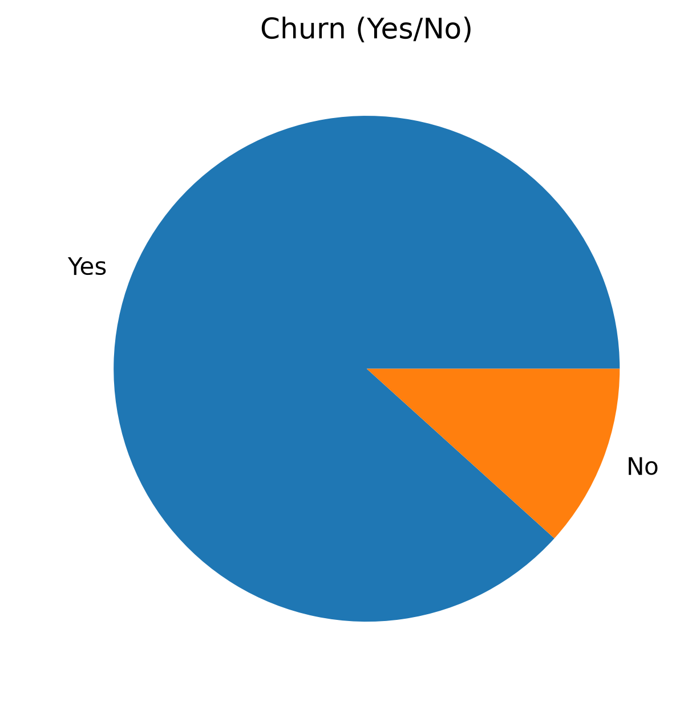
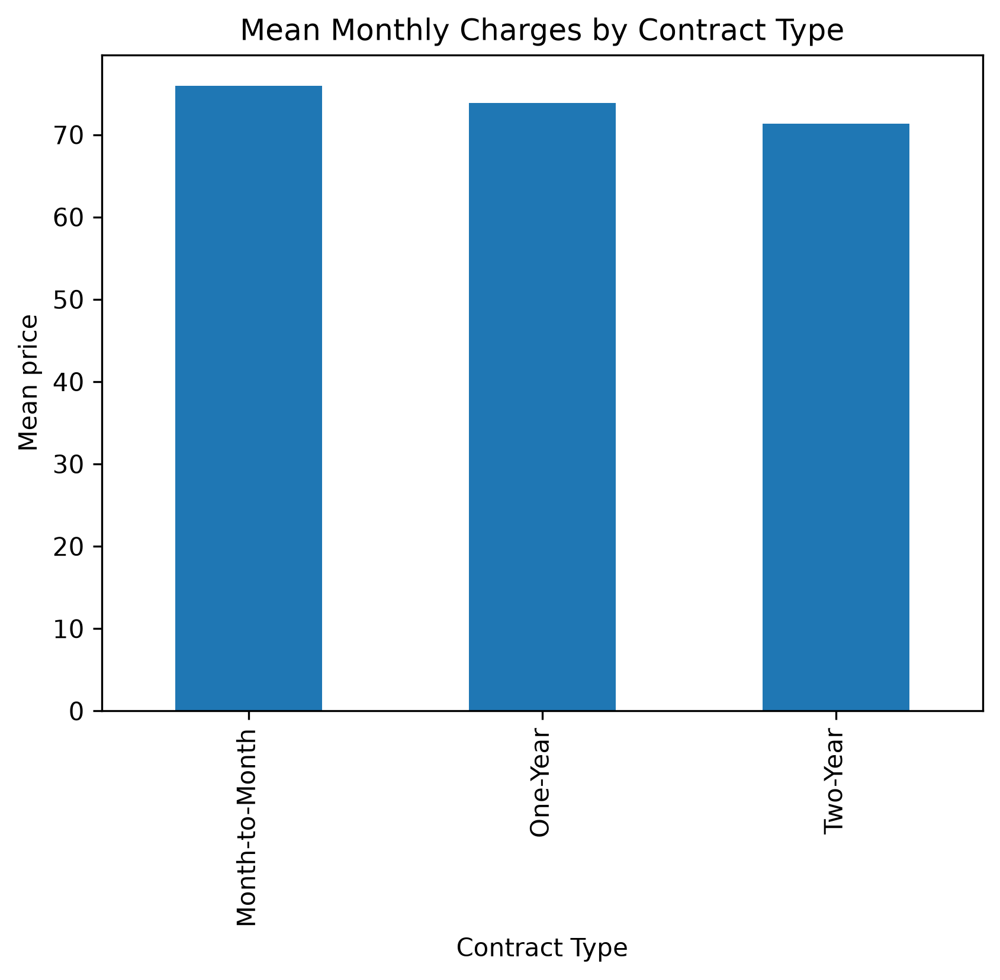
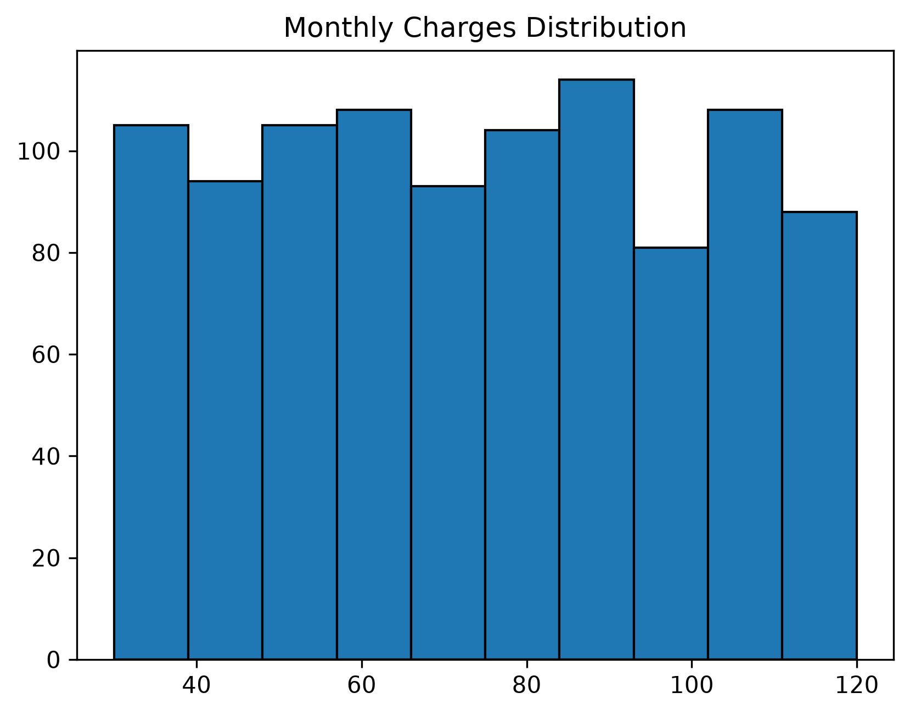
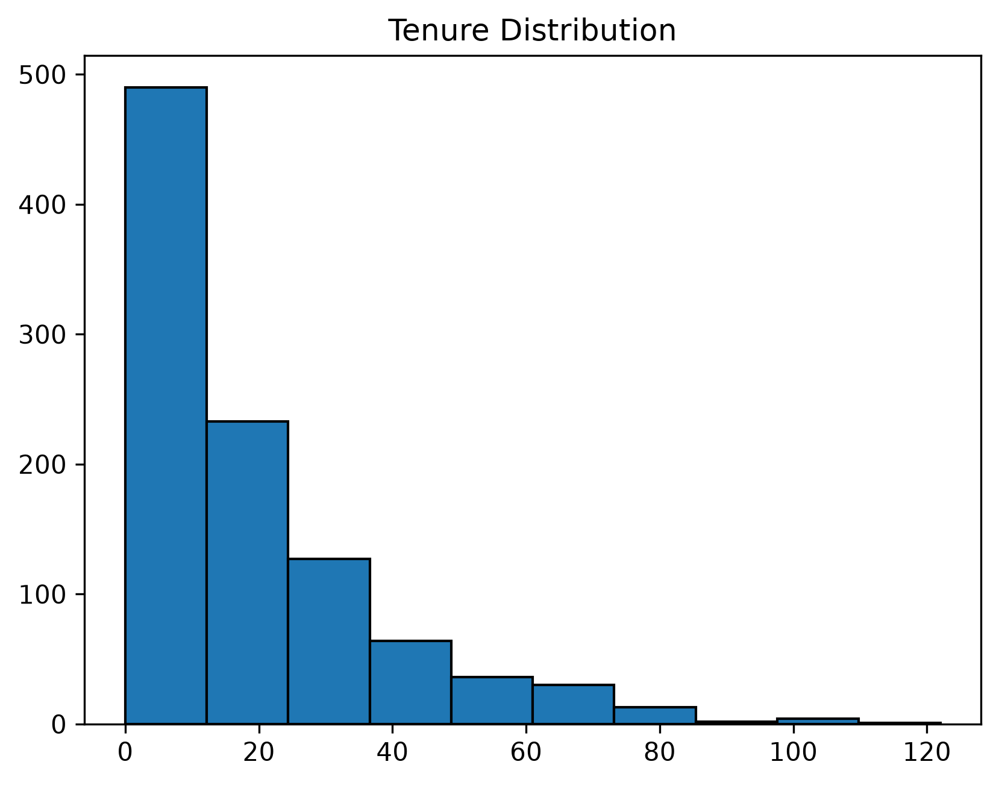

# Customer Churn Prediction

## Overview

An end-to-end machine learning project to predict customer churn in a telecom business. This project covers data exploration, preprocessing, model training, hyperparameter tuning, evaluation, and a Streamlit application for making predictions.

The goal is to explore how machine learning can help identify customers who may be at risk of leaving a service.

## Business Problem

Customer churn occurs when customers stop using a company's services. Identifying customers who may churn can help businesses investigate potential retention opportunities and make more informed decisions.

This project builds a classification model to predict whether a customer will churn based on selected customer attributes.

## Technologies Used

- Python
- Pandas
- NumPy
- Scikit-learn
- StandardScaler
- Support Vector Machine (SVM)
- GridSearchCV
- Matplotlib
- Streamlit
- Joblib

## Dataset and Features

The project uses customer churn data for exploratory analysis and model development.

The four features selected for model training are:

- `Age`
- `Gender`
- `Tenure`
- `MonthlyCharges`

**Target variable:** `Churn`

The target is encoded as:

- `0` = No Churn
- `1` = Churn

Gender is encoded as:

- `0` = Male
- `1` = Female

These are the features used by the current model; additional customer attributes could be explored in future versions.

## Project Workflow

1. Load and inspect the dataset.
2. Check data quality and handle missing values.
3. Perform exploratory data analysis (EDA).
4. Select features and encode categorical variables.
5. Split the data into training and testing sets.
6. Scale numerical features.
7. Train and tune machine learning models.
8. Evaluate predictions using classification metrics.
9. Save the trained model and scaler.
10. Build a Streamlit application for interactive predictions.

## Exploratory Data Analysis

### 1. Customer Churn Distribution

This chart shows the distribution of churned and retained customers. The difference between the two classes is important because class imbalance can affect model training and evaluation.

### 2. Average Monthly Charges by Contract Type

This chart compares average monthly charges across month-to-month, one-year, and two-year contract types.

### 3. Monthly Charges Distribution

This histogram illustrates the distribution of monthly charges across customers.

### 4. Tenure Distribution

This histogram shows the distribution of customer tenure, providing an overview of how long customers have stayed with the company.

## Model Development

A Support Vector Machine (SVM) was used as the current model. `GridSearchCV` was used to evaluate hyperparameter combinations through cross-validation.

The model was trained using the selected customer features. Feature scaling was applied before model training and evaluation.

The model's performance was evaluated on a held-out test set of 200 customers.

## Model Evaluation

The current tuned SVM produced the following results on the test set.

Metric                 Result 

Accuracy               75.00% 
Balanced Accuracy      66.96% 
Precision — No Churn   25.00% 
Recall — No Churn      56.52% 
F1-score — No Churn    34.21% 
Precision — Churn      93.20% 
Recall — Churn         77.40% 
F1-score — Churn       84.56% 

### Confusion Matrix

Actual Class   Predicted No Churn   Predicted Churn 

No Churn             13                   10 
Churn                40                   137 

The model correctly identified 13 of the 23 customers who did not churn and 137 of the 177 customers who churned.

### Interpretation

The model achieved 75% accuracy and approximately 66.96% balanced accuracy. It identified both churn and non-churn customers, unlike the initial version, which predicted churn for every test customer.

However, performance remains limited for the non-churn class. The model's 25% precision for No Churn indicates that many customers predicted not to churn actually churned in the test set.

Accuracy alone would not adequately describe this model's performance because the dataset contains substantially more churn customers than non-churn customers.

These results represent the current experiment and should not be interpreted as evidence that the model is ready for real-world retention decisions.

## Key Learnings

- Explored customer attributes and their distributions using EDA.
- Practiced feature selection and categorical encoding.
- Applied feature scaling before SVM training.
- Used GridSearchCV for hyperparameter tuning.
- Learned why accuracy can be misleading on imbalanced datasets.
- Used a confusion matrix, precision, recall, F1-score, and balanced accuracy to examine model performance.
- Identified limitations that require further model evaluation.

## Limitations and Future Work

The current model has limitations, particularly in identifying non-churn customers reliably.

Planned improvements include:

- Compare SVM with Logistic Regression and Random Forest using the same test split.
- Investigate precision, recall, and decision thresholds for both classes.
- Evaluate ROC-AUC and precision-recall curves.
- Investigate the impact of class weighting and alternative modelling approaches.
- Explore additional customer features.
- Validate the model on additional unseen customer data.
- Improve preprocessing consistency and model evaluation through a reproducible pipeline.

## Streamlit Application

The project includes a Streamlit application that accepts customer information and displays a churn prediction.

The application uses the saved model and scaler generated during model development.

## Disclaimer

This project was developed for educational and portfolio purposes. The current model has limitations and has not been validated for production customer-retention decisions.
